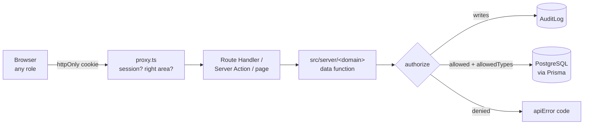
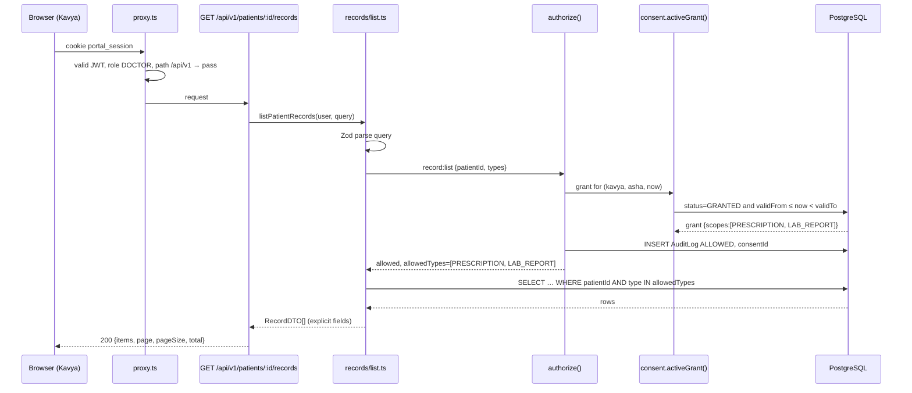
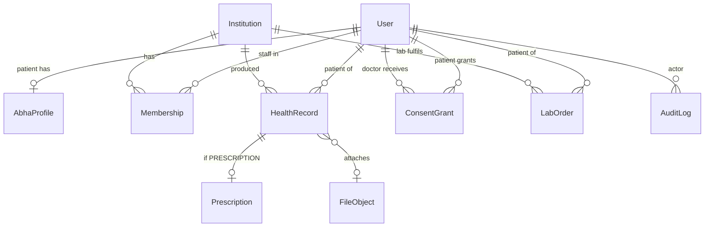

# System architecture

One Next.js app, one security boundary. This page explains how a request moves
through the system and why it's built this way. Contracts are in
[`../CONTRACTS.md`](../CONTRACTS.md); the hardest module has its own page:
[`identity-and-consent.md`](identity-and-consent.md).

---

## The rule that governs everything
**Every read or write of patient data goes through `authorize()`, which also writes the audit row.**

### Why it's built this way
- **Two builders, one policy.** If each area checked access its own way, the project would have two
  slightly different ideas of "authorized doctor", and the weaker one would be the real policy. One function means one policy, tested once as a table.
- **The check returns *what* is allowed, not just *whether*.** `authorize()` returns
  `allowedTypes` for list queries, so the scope filter is applied **in the SQL**, by the code that
  decided it. A domain can't accidentally filter on the client.
- **Denies are logged.** The audit log is both a feature (patient access log, admin audit) and the
  evidence that the rules hold.
- **Proxy is defence in depth, not the defence.** It makes navigation sensible; it doesn't make
  decisions (D6).

---

## One request, end to end
Dr Kavya opens Asha's records after Asha approved prescriptions + lab reports for 7 days.

After Asha revokes, the same request stops at `activeGrant` → no grant → audit `DENIED
NO_ACTIVE_CONSENT` → `403 CONSENT_REQUIRED`. Nothing is cached, so the very next request sees it.

---

## One app, three entry points (D20, D22)
Front end and back end are both Next.js. Every entry point ends in a `src/server/<domain>/` data
function, which calls `authorize()`.

| Entry point | Used for | Example |
|---|---|---|
| **Server Component** calls a data function | Pages that render data on the server | Patient timeline, Consent Center, pharmacy prescription, admin audit |
| **Server Action** | Every form write | Upload, approve consent, prescribe, upload lab result, dispense, verify staff |
| **Route Handler** `/api/v1/*` | Auth, reads from client components (React Query), file downloads, health check | ABHA OTP, doctor viewer's records, `/files/:id`, `/health` (Edge) |

| Area | Route group | Rendering |
|---|---|---|
| Public | `(public)/` | Static / ISR (`revalidate = 3600`) |
| Auth | `(auth)/` | Dynamic |
| Patient, doctor, lab, pharmacy, admin | `patient/`, `doctor/`, `lab/`, `pharmacy/`, `admin/` | **Always dynamic**: they read the session cookie, and nothing per-user is cached (TRAPS §3) |

Why one app and not a separate React front end: [Master D20](../00_MASTER_PLAN.md#part-9--decision-log).
A second app would add bearer tokens, CORS and a second deploy, for no feature a user sees.

## Data model at a glance

Full fields: [`../CONTRACTS.md`](../CONTRACTS.md) §2.

---

## Conventions frozen across all of it
Master Part 5. The four that matter most at the architecture level:
1. Patient data only through `authorize()`.
2. `CONSENT_REQUIRED` (doctor) vs `404` (everyone else) vs empty list: three different things.
3. No per-user data on a cached route.
4. DTOs built field by field; Prisma rows never leave `src/server/`.

## What the design deliberately does not do
- **No real federation.** Institutions are rows, not separate systems (D3).
- **No consent manager service.** The consent engine is a module in the same backend.
- **No background jobs.** Expiry is a comparison at read time (D9).
- **No microservices, no message queue.** Four students, two weeks.
