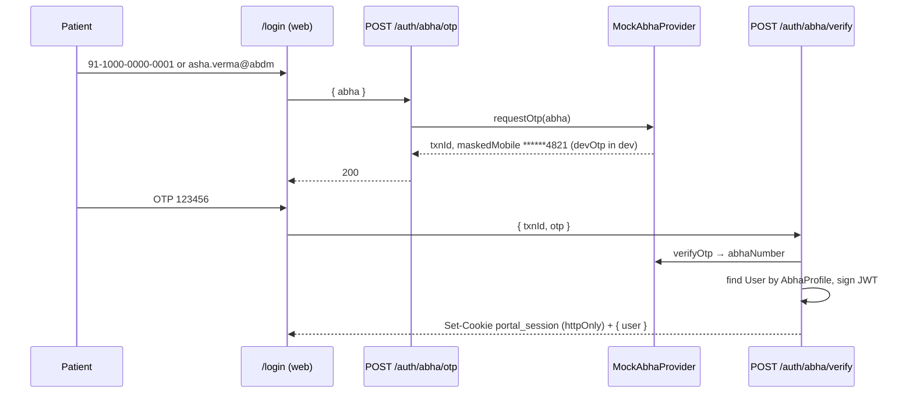
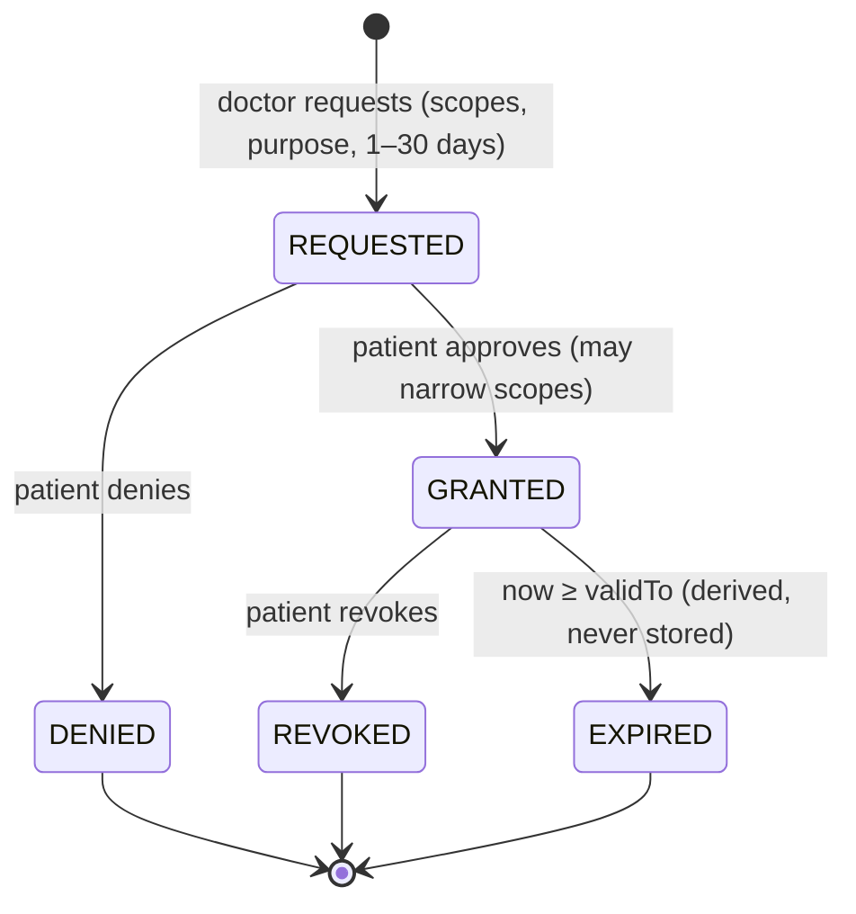

# Identity and consent

Owner: Harshita. The module every other feature depends on. Brief:
[`../team/harshita.md`](../team/harshita.md).

---

## 1. Patient sign-in with ABHA (mocked)

- **The interface is the point.** `AbhaProvider` has three methods (`requestOtp`, `verifyOtp`,
  `getProfile`). A real ABDM implementation would replace `MockAbhaProvider` and nothing else:
  not the routes, not the session, not the screens.
- Unknown ABHA gets the same response shape as a known one, so the login form can't be used to
  discover which ABHA numbers exist.
- Limits: OTP valid 5 minutes, 3 wrong attempts kills the transaction, 3 requests per ABHA per 10 minutes.

Staff (doctor, pharmacy, lab, admin) sign in with email + password (bcryptjs), D8 + D19. Unverified
staff are refused with `STAFF_UNVERIFIED` until an admin verifies them.

## 2. Sessions
| | |
|---|---|
| Carrier | Cookie `portal_session`, httpOnly, SameSite=Lax, Secure in production. The only carrier (D20) |
| Lifetime | 8 h |
| Readable by JavaScript | No |
| Read by | `getSession()` / `requireSession()` |

The JWT carries `SessionUser` (CONTRACTS §5). `verified` and `institutionIds` are in the token so
`proxy.ts` can make coarse decisions without a DB call. `authorize()` trusts the token's `verified`
flag; that is safe because verification only goes one way (admins verify, nobody un-verifies), so a
token can only be out of date in the safe direction (says unverified, user logs in again).

## 3. Consent lifecycle

- **A grant is active iff** `status = GRANTED ∧ validFrom ≤ now < validTo`. Evaluated in the query,
  on every read (D9).
- **Approve can only narrow:** `approved = requested ∩ submitted`, non-empty.
- **Re-requesting** after DENIED/REVOKED/EXPIRED creates a new grant; history is kept.
- **Duplicate requests:** an open `REQUESTED` grant for the same doctor + patient is returned
  instead of creating a second one.

## 4. The decision
```
decide(user, action, resource, grant):
  if staff and not verified                          → deny STAFF_UNVERIFIED
  if action not in matrix[user.role]                 → deny FORBIDDEN (wrong role for this action at all)
  patient:  resource.patientId == user.id            → allow, else deny NOT_FOUND
  doctor:   record.authorId == user.id               → allow (AUTHOR)
            grant active and record.type ∈ scopes    → allow (CONSENT, consentId)
            list: grant active                       → allow, allowedTypes = scopes ∩ requested types
                  (author access does NOT apply to lists, so a revoke shows "Consent required")
            otherwise                                → deny CONSENT_REQUIRED (NO_ACTIVE_CONSENT | SCOPE_EXCLUDED)
  lab:      order.labInstitutionId ∈ institutionIds  → allow, else NOT_FOUND
  pharmacy: role is PHARMACY                         → allow, else NOT_FOUND
            (unknown or expired share code → NOT_FOUND, checked in the pharmacy data function
             after authorize(), so the attempt is still audited)
  admin:    institution/staff/audit actions only     → allow; anything clinical → NOT_FOUND
```
`decide` is pure (no DB) and tested as a table. `authorize` = load grant → `decide` → write audit → return.

## 5. Audit
Every `authorize()` call writes one `AuditLog` row: actor, role, action, resource, patient,
consent used, outcome, reason. Two readers:
- **Patient** (`/patient/access-log`, data function `listMyAccessLog`): reads concerning their
  `patientId`, shown as "who viewed my records", including denied attempts (muted, "No consent at the time").
- **Admin** (`/admin/audit`): everything, filterable, with no clinical content in the view.

## 6. What would change for real ABDM
| Here | Real |
|---|---|
| `MockAbhaProvider` | ABDM ABHA APIs via sandbox credentials (M1) |
| Consent engine in our DB | ABDM Consent Manager issuing consent artefacts (M3) |
| Institutions as rows | Registered HIPs/HIUs exchanging data through the gateway (M2/M3) |
| Seeded `hprId` | Health Professional Registry lookup |
The interfaces (`AbhaProvider`, `activeGrant()`) are where those would plug in.
